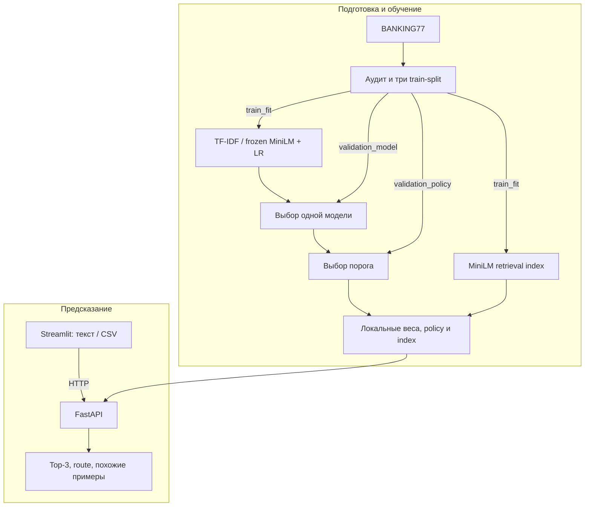

# Support Router

Учебный NLP/ML-проект для маршрутизации английских обращений в банковскую поддержку.
Реализованы классификация по **77 intents BANKING77**, передача неуверенных случаев
человеку и поиск похожих обращений. Сравнены TF-IDF + Logistic Regression и
замороженный MiniLM + Logistic Regression. Приложение работает локально на CPU.

Это проект для исследования и демонстрации ML-процесса: от аудита данных и сравнения
baseline до API, интерфейса и воспроизводимого запуска. Коммерческое внедрение и
экономический эффект на реальной службе поддержки не оценивались.

## Возможности

- Категория и top-3 с model scores для одного обращения.
- Автоматическая маршрутизация либо manual review по выбранному порогу уверенности.
- Три похожих примера из train_fit для контекста оператору.
- FastAPI с JSON batch, health/readiness и OpenAPI; Streamlit с тремя вкладками.
- CSV с сохранением порядка, повторяющихся пользовательских id и ошибок отдельных строк.
  При скачивании формулоподобные ячейки экранируются; данные остаются в памяти.

## Результаты на official test

Champion: **minilm-C4**, run `2026-10-20T16-06-04.937473Z-76b6db38`.
Модель выбрана по validation до просмотра test; после выбора порога refit не выполнялся.

| Показатель | Результат |
| --- | ---: |
| Размер test | 3080 обращений |
| Accuracy | 91,75% — 2826 правильных |
| Macro-F1 | 0,9174 |
| Top-3 accuracy | 98,25% — 3026 правильных |
| Coverage автоматической обработки | 90,13% — 2776 обращений |
| Accuracy принятой группы | 95,71% — 2657 из 2776 |
| Ручная проверка | 9,87% — 304 обращения |

В автоматической группе остаются **119 ошибок**. Ручная очередь содержит 135 ошибочных
и 169 правильных top-1 модели: порог перехватывает 53,15% ошибок. Это не измерение
точности оператора. 95%-й интервал Уилсона для accepted accuracy — [94,89%, 96,41%];
он пересекает 95%, поэтому результат benchmark не подтверждает гарантированный SLA.
[Точные значения и количества решений](reports/public/benchmark.json).

Median полного ответа с retrieval — **25,96 мс**, p95 — 31,47 мс на Intel i7-3770,
4 вычислительных потока. Замер: 10 warmup + 100 одиночных запросов внутри процесса,
без HTTP, сети и конкурентной нагрузки. Это не задержка браузера и не QPS.
RSS 811,5 MiB — снимок, не peak RAM.
[Условия и версии](reports/public/latency.json).

## Пример использования

После запуска API:

```bash
curl -X POST http://127.0.0.1:8000/predict -H "Content-Type: application/json" -d '{"text":"My card payment appears twice in the app."}'
```

Сокращённый **сохранённый ответ**, без изменения чисел:

```json
{
  "predicted_category": "transaction_charged_twice",
  "confidence": 0.7462266683578491,
  "routing_decision": "auto_route",
  "threshold": 0.41993725299835205
}
```

[Исходный пример и top-3](reports/public/example_response.json). Ответ API также
содержит run_id, request_id, warnings и похожие обращения. Для UI есть небольшой
[демонстрационный CSV](examples/finishing_scenario.csv): корректный текст, пустая
строка, слишком длинный текст и буквальное NA. Последнее остаётся строкой, а не null.
Файл подходит для проверки обработки ошибок и безопасного экспорта.

## Решение и сравнение подходов

| Лучший вариант подхода | Validation macro-F1 | Median инференса на validation |
| --- | ---: | ---: |
| TF-IDF + Logistic Regression, C=4 | 0,8737 | 1,63 мс |
| Frozen MiniLM + Logistic Regression, C=4 | 0,9180 | 19,02 мс |

Прирост validation macro-F1 — **4,43 процентного пункта**. Baseline быстрее, MiniLM
лучше по выбранной метрике. Это сравнение на validation_model, n=1499; отдельный
baseline test не измерялся. Всего проверены C={0.5,1,4} для обоих представлений.
Полная [таблица шести конфигураций](docs/experiments.md) включает fit и latency.

TF-IDF использует word n-grams (1,2). MiniLM выдаёт нормализованные embeddings
размерности 384, затем обучается линейный классификатор. Encoder **заморожен**:
fine-tuning трансформера не выполнялся. Указанное время fit LR на готовых embeddings
не включает их вычисление. Один MiniLM используется также для retrieval; поиск
выполнен точным сравнением с NumPy-индексом из 6994 train_fit примеров.

Confidence — **max predict_proba** по 77 классам; threshold — порог, с которым
сравнивается confidence. Scores не калиброваны и не являются гарантией правильности.
Сумма показанных top-3 не обязана быть единицей. Похожие примеры дают контекст,
но не причинное объяснение решения LR.

## Данные и протокол

BANKING77: 10003 исходных train и 3080 test. Из train исключены 7 текстовых совпадений
с test и 4 same-label дубликата; осталось 9992. Для удаления overlap использованы
тексты, не метки test. Нормализация: Unicode NFC, trim и свёртка пробелов;
casefold дополнительно используется для поиска дубликатов. Test сохранён неизменным.
Это вариант benchmark с очищенным train, что ограничивает сравнение с публикациями.

Стратифицированный split, seed=42: train_fit **6994**, validation_model **1499**,
validation_policy **1499**; в каждой части 77 классов. TF-IDF, LR и retrieval используют
только train_fit. Модель выбирается на validation_model по macro-F1 с заранее
заданным latency tie-break. Порог выбирается отдельно на validation_policy:
максимальная coverage при accepted accuracy ≥95% и accepted count ≥100.
Если условие недостижимо, автоматическая маршрутизация выключается.

Сохранены SHA-256 ресурсов и связи model/selection/policy/index; проверяются классы
predict_proba и отсутствие нормализованных пересечений split. Протокол, fingerprints
и лицензии описаны в [DATA_CARD](DATA_CARD.md) и [MODEL_CARD](MODEL_CARD.md).

## Архитектура и стек



Стек: Python 3.11, scikit-learn, Sentence Transformers, CPU PyTorch, NumPy/Pandas,
FastAPI/Pydantic, Streamlit, pytest, Ruff, uv и Docker Compose. API загружает один
classifier и один encoder; UI работает как HTTP-клиент. Ключевые модули находятся
в `src/support_router`, параметры — в `configs/default.toml`.

## Быстрый запуск

Нужны Python 3.11 и [uv](https://docs.astral.sh/uv/getting-started/installation/).
Для первой подготовки требуется интернет к GitHub, Hugging Face/CDN, PyPI и CPU-index
PyTorch. Токен и платные API не нужны. Веса и датасеты загружаются программно.

```bash
git clone https://github.com/GodwynCornelia/NLP_pet.git
cd NLP_pet
uv sync --frozen
uv run --frozen python -m support_router bootstrap
```

В Windows PowerShell перед командами задайте `$env:PYTHONUTF8 = "1"`.
Bootstrap выполняет полный цикл один раз и сохраняет локальные результаты;
повторный запуск использует checkpoints. Затем в двух терминалах:

```bash
uv run --frozen uvicorn support_router.api.main:app --host 127.0.0.1 --port 8000 --workers 1 --log-config configs/logging.json
```

```bash
uv run --frozen streamlit run src/support_router/ui/app.py --server.address=127.0.0.1 --server.port=8501 --server.maxUploadSize=5 --browser.gatherUsageStats=false
```

UI: <http://127.0.0.1:8501>, API docs: <http://127.0.0.1:8000/docs>.
Готовность: `/ready`. Остановка — Ctrl+C. Docker, отдельные этапы CLI, переменные
окружения и диагностика описаны в [setup.md](docs/setup.md).

## Проверки и воспроизводимость

```bash
uv run --frozen pytest -q
uv run --frozen ruff check src tests scripts
uv run --frozen ruff format --check src tests scripts
uv run --frozen pytest -q -m integration
```

Integration требует bootstrap и реальных локальных весов; тесты используют запрет
внешних sockets. Синтетические fixtures не выдаются за ML-метрики. Проверены Docker
build/prepare/up, UI→API, predict/batch/CSV, AppTest, offline-инференс с сетью none и
restart без изменения артефактов. Ручные скриншоты подтвердили основные вкладки;
[чек-лист](docs/manual_ui_checklist.md) отдельно отмечает неподтверждённые шаги.

Ресурсы закреплены commit/revision и SHA-256 в [resources.lock.json](configs/resources.lock.json),
зависимости — в `uv.lock`. Чистый Linux-прогон воспроизвёл те же test-агрегаты, сохранив
исходный run. Его threshold немного отличается. Это повтор фиксированного протокола
на уже известном test, **не новая независимая оценка**. Подтверждения и происхождение
публичных сводок — в [reproducibility.md](docs/reproducibility.md).

## Ограничения и развитие

Только английские банковские intents. Возможен уверенный ответ на русский, бессмыслицу
или постороннюю тему: порог не является OOD-детектором. Encoder учитывает максимум
256 токенов; длинный ввод усечён с warning. HTTP/QPS, peak RAM, работа на современных
обращениях банка и качество итогового решения человека не измерялись.

Возможное развитие: калибровка, независимый OOD-набор и нагрузочное тестирование.
Новые решения потребуют новых данных для оценки: просмотренный test нельзя снова
использовать для подбора. [Предварительный разбор ошибок](docs/error_analysis.md)
явно отделяет гипотезы от подтверждённых причин.

## Документация и лицензии

[Эксперименты](docs/experiments.md) · [Воспроизводимость](docs/reproducibility.md) ·
[Данные](DATA_CARD.md) · [Модель](MODEL_CARD.md) · [Запуск](docs/setup.md).

[BANKING77](https://github.com/PolyAI-LDN/task-specific-datasets) — CC BY 4.0;
[all-MiniLM-L6-v2](https://huggingface.co/sentence-transformers/all-MiniLM-L6-v2) — Apache 2.0.
Атрибуция, изменения корпуса и лицензии зависимостей — в
[THIRD_PARTY_NOTICES](THIRD_PARTY_NOTICES.md). Лицензия собственного кода пока не задана.
